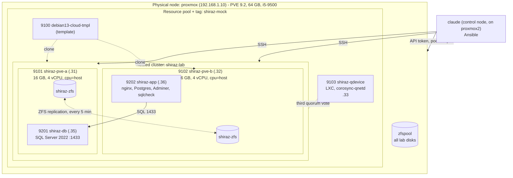

# indaGO Shiraz mock on nested Proxmox

Status: built and tested end to end on 2026-10-06. Every number below was measured in this lab.

## Architecture



All addresses are in 192.168.1.0/24 on the physical `vmbr0`. Each nested host bridges its single
NIC as its own `vmbr0`, so the mock servers sit directly on the LAN.

## Mapping to the DMW&H spec

Rows use only what the spec summary provided for this lab states. Production sizing is left to be
filled in from the vendor document rather than guessed.

| Vendor reference design | This lab | Why |
|---|---|---|
| Two VMware hosts, Host A and Host B | Two nested Proxmox VE 9.2 VMs, `shiraz-pve-a` and `shiraz-pve-b` | Evaluating Proxmox as the VMware replacement; nested so it fits on one physical node |
| vCenter / HA cluster | Proxmox cluster `shiraz-lab` with HA manager | Same role: placement, migration, restart on host failure |
| Third vote / witness | QDevice (`corosync-qnetd`) in a small container | A 2-node cluster cannot keep quorum alone when one node is lost |
| Shared storage | Local ZFS on each host + scheduled replication | Matches the existing home cluster. Asynchronous: see "Storage" below |
| Database server: Windows Server + SQL Server 2022 | `shiraz-db`: Ubuntu 24.04 + SQL Server 2022 for Linux container | No Windows licence needed; same engine, port 1433, same login model |
| Application server (containerized indaGO) | `shiraz-app`: Ubuntu 24.04 + Docker compose stack listening on the spec's ports | Stand-in workloads that exercise the same ports and the app-to-DB dependency |
| Core server | Not built; inventory slot reserved (`shiraz-core`, .37, VMID 9203) | Added later with one inventory entry |
| Server sizing | 6 GB RAM, 2 vCPU, 15 GB disk each | Scaled down to fit. *Production values: fill in from the spec* |
| Firewall ports 22, 80, 443, 1433, 1434, 8080, 8083, 15432, 15433 | Same list, one variable, applied with UFW | See limitation about Docker and UFW |
| Power management disabled | `sleep`, `suspend`, `hibernate`, `hybrid-sleep` targets masked | Mirrors the rule on a Linux guest |
| Vendor support account | Local `dmwh-admin`, sudo, password never expires | Mirrors the account the vendor asks for |
| Daily 30-minute maintenance window | `maintenance.yml`: serial patch + image refresh, timed | Rehearses fitting routine work into the window |

## Design decisions

### Proxmox VE install method
Nested hosts start as the Debian 13 cloud image and are converted with the official
"Install Proxmox VE on Debian 13 Trixie" procedure, expressed as the `pve_host` role. That keeps
the whole install in Ansible. **Real hosts at work would be installed from the Proxmox ISO**
(optionally with the automated installer and an answer file); the end state is the same PVE 9.2.

Differences from an ISO install that the role closes: hostname resolves to the real address in
`/etc/hosts`, cloud-init is disabled after first boot, netplan and systemd-resolved are replaced
by `/etc/network/interfaces` with a `vmbr0` bridge and a static `resolv.conf`, the NIC name is
pinned to `nic0` by MAC, the stock Debian kernel is removed, and sshd allows root and password
logins as the ISO install does.

### Storage: ZFS + replication (default) and the alternatives
| Option | Migration | Host failure | Cost |
|---|---|---|---|
| **ZFS + replication** (built) | Live migration copies only the delta since the last sync | VM restarts on the other host from the last replica: **loses up to one replication interval (5 min)** | No extra hardware; storage is not a single point of failure |
| NFS / iSCSI shared storage | Live migration moves RAM only | VM restarts with no data loss | The storage box becomes a single point of failure and must itself be redundant |
| Ceph | As shared storage | No data loss | Needs three or more nodes and fast networking |

The vendor design assumes shared storage, so its failover loses no committed data. With ZFS
replication the same event rolls the database back by up to the replication interval. For a
warehouse control database that is the main thing to weigh before choosing Proxmox with local
ZFS over shared storage.

### Sizing on the physical node
Each nested host has 16 GB so that either can run both 6 GB mock servers during a drain or
failover (12 GB guests + Proxmox + a 1 GB ZFS ARC). Two hosts plus the QDevice commit 32.5 GB of
the node's 64 GB.

**Capacity warning:** `ubuntudesktop` (24 GB) is HA-managed on `proxmox2`. If `proxmox2` fails
while this lab is running, HA cannot fit it on `proxmox`. The nested hosts therefore do not start
at boot (`onboot: 0`); power the lab off when it is not in use (see runbook).

### Keeping the lab out of the way
- Everything is in pool `shiraz-mock` and tagged `shiraz-mock`.
- The API token has guest permissions on that pool only.
- Lab disks carry `backup=0`, so the node's nightly "back up all guests" job should store only a
  config stub for the nested hosts (plus the small QDevice container). Not yet observed.
- No physical-cluster HA or replication is configured for lab guests.

## Runbook

All commands run from the repo root on the control node. Every runbook playbook ends with the
full `verify.yml` check and exits non-zero if anything is unhealthy.

### Check health
```bash
ansible-playbook playbooks/shiraz/verify.yml
```
Prints one PASS/FAIL line per check: cluster quorum and QDevice vote, replication, HA services,
SSH to each mock server, containers running, ports listening, power management masked, and the
application-to-database SQL connection.

### Migrate a server
```bash
ansible-playbook playbooks/shiraz/migrate.yml -e vm=shiraz-db -e target=shiraz-pve-b               # live
ansible-playbook playbooks/shiraz/migrate.yml -e vm=shiraz-db -e target=shiraz-pve-a -e mode=offline
```
1. Refuses unless the cluster is quorate and the server's replication is healthy.
2. HA-managed server: asks the HA manager (`ha-manager migrate` for live, `relocate` for
   offline). Unmanaged server: `qm migrate` directly.
3. Waits until the server runs on the target, then until the SQL probe passes again.
4. Reports how long the database was unreachable from the application, then verifies.

By hand on a node: `ha-manager migrate vm:9201 shiraz-pve-b` and watch `ha-manager status`.
Replication reverses direction by itself after every move.

### Drain a host for maintenance
```bash
ansible-playbook playbooks/shiraz/drain-host.yml -e host=shiraz-pve-a -e maintenance=true
# ... do the maintenance ...
ansible-playbook playbooks/shiraz/drain-host.yml -e host=shiraz-pve-a -e maintenance=false
ansible-playbook playbooks/shiraz/migrate.yml -e vm=shiraz-db -e target=shiraz-pve-a     # bring servers home
```
Moves every mock server on the host to the other host, one at a time. `maintenance=true` also
runs `ha-manager crm-command node-maintenance enable <host>` so the HA manager will not place
or recover anything there. `maintenance=false` only clears that flag. Servers stay where the
drain put them: the HA manager only returns guests that it evacuated itself.

### Failover test
```bash
ansible-playbook playbooks/shiraz/failover-test.yml -e confirm_failover=yes
```
1. Pre-checks: all three votes present, each affected server has a healthy replica.
2. Hard-stops the nested host VM from the physical node (no clean shutdown).
3. Confirms the survivor is still quorate with 2 of 3 votes (its own plus the QDevice).
4. HA-managed servers: waits while the HA manager fences the dead node (about 60 s) and
   restarts them on the survivor. Unmanaged servers: recovers by hand, which is
   `mv /etc/pve/nodes/<dead>/qemu-server/<id>.conf /etc/pve/nodes/<survivor>/qemu-server/`
   followed by `qm start <id>`.
5. Reports what the application saw and verifies the degraded lab. The failed host stays off.

Bring the host back, wait for it to rejoin and resync, and optionally move servers home:
```bash
ansible-playbook playbooks/shiraz/failover-test.yml -e confirm_failover=yes --tags recover
ansible-playbook playbooks/shiraz/failover-test.yml -e confirm_failover=yes --tags recover -e failback=yes
```
Or do the whole cycle in one run with `-e failover_recover=yes -e failback=yes`.

**Data loss is expected.** A recovered server is rolled back to its last replication. In the
tests the application server's own log lost everything written after the last sync.

### Daily maintenance window
```bash
ansible-playbook playbooks/shiraz/maintenance.yml
```
One server at a time, database first: package updates, reboot if the updates need one, newer
container images, prune, then a health gate before the next server. Reports the total against
the 30-minute window.

### Add `shiraz-core`
1. `inventory/hosts.yml`: uncomment the `shiraz_core` group and its line under `mock_servers`.
2. `inventory/host_vars/shiraz-core.yml`:
   ```yaml
   ---
   pve_guest_vmid: 9203
   pve_guest_home_node: shiraz-pve-a
   ```
3. `inventory/group_vars/shiraz_core.yml`: `verify_containers` and `verify_ports` for whatever it
   runs (see `shiraz_app.yml`).
4. If it needs software beyond the baseline, add a role and one play for `shiraz_core` at the
   end of `03-mock-servers.yml`. Sizing, replication, HA, the baseline and Docker come from the
   `mock_servers` group with no further changes.
5. `ansible-playbook playbooks/shiraz/03-mock-servers.yml`

Capacity: three 6 GB servers need 18 GB, more than one 16 GB nested host. With `shiraz-core`
added, a drain or failover can no longer put everything on one host unless the nested hosts
get more RAM or the servers get less.

### Power the lab off and on
The nested hosts do not start with the physical node, and they hold 32 GB of its RAM while
running. On `proxmox`, as root:
```bash
qm shutdown 9101 --timeout 300 & qm shutdown 9102 --timeout 300; wait; pct shutdown 9103   # off, about 40 s
pct start 9103; qm start 9101; qm start 9102                                                # on
```
After power-on the cluster forms, HA starts both servers and the SQL probe passes again within
about two minutes, with no manual steps. Then run `verify.yml`.

### Rebuild or remove
```bash
ansible-playbook playbooks/shiraz/destroy.yml -e confirm_destroy=yes -e layer=mock
ansible-playbook playbooks/shiraz/03-mock-servers.yml          # rebuilds both servers in about 7 minutes
```
To remove the lab completely: `destroy.yml -e layer=nested -e destroy_templates=yes`, then on
`proxmox` remove what you created by hand:
```bash
pveum user token remove ansible-shiraz@pve ansible
pveum user delete ansible-shiraz@pve
pveum role delete ShirazLabProvisioner
pveum pool delete shiraz-mock
```

## Measured results

| Operation | Duration | Database unreachable from the app |
|---|---|---|
| Live migration of `shiraz-db` | 46 to 53 s | about 4 s (one failed probe) |
| Live migration of `shiraz-app` | 46 to 53 s | none |
| Offline migration of `shiraz-db` | 46 s to relocate | about 49 s (includes SQL Server start) |
| Drain a host holding one server | about 50 s | about 4 s |
| Maintenance, both servers, one reboot | 1.4 min | none |
| Host failure, HA recovery, **no** cloud-init drive | server running after 96 to 99 s | 104 s |
| Host failure, HA recovery, **with** cloud-init drive | server running after about 400 s | about 7 min |
| Failed host back: rejoin, resync, verify | 3 to 4 min | none |
| Full lab power-off / power-on | 40 s / about 2 min | n/a |
| Build from nothing | Phase 1 about 10 min, Phase 2 about 5, Phase 3 about 7 | n/a |

HA recovery time is roughly: 60 s for the HA manager to fence the dead node, then VM boot,
then SQL Server start.

## What the lab taught (relevant to the real design)

1. **Local ZFS replication is not shared storage.** A host failure rolls the server back to its
   last sync, up to the replication interval (5 minutes here; Proxmox allows down to 1 minute).
   The vendor design assumes shared storage and loses nothing. For a warehouse control
   database this is the main decision: shorter interval and accepted loss, or real shared
   storage (which then must itself be redundant).
2. **Do not put a cloud-init drive on a replicated, HA-managed VM.** The drive is local and is
   not replicated. On HA recovery the VM start waits 300 s for the missing device, turning a
   100 s recovery into 7 minutes. Afterwards the stale copy on the failed host makes the next
   migration back abort with "volume already exists". The mock servers now drop the drive after
   first boot (`pve_guest_remove_cloudinit_drive`), and `migrate.yml` frees a stale copy if it
   finds one. Vendor-built VMs would not have such a drive, but templated ones might.
3. **A two-node cluster needs its third vote.** With the QDevice, the survivor stayed quorate
   (2 of 3) and HA could act. Without it, the survivor would have frozen.
4. **HA requests are asynchronous.** Start, stop and migrate calls for an HA-managed VM return
   as soon as the request is filed. Automation has to poll the real state, and a failed HA
   migration simply leaves the service "started" on the source.
5. **Cluster-wide status lags a dead node.** `/cluster/resources` kept reporting the dead host's
   VMs as "running" for a while; ask the node that should now be running them (`qm status`).
6. **A recovered host needs one replication run before anything can move back to it.** Until
   that sync its disks are stale. Replication direction itself reverses automatically.
7. **Maintenance mode does not bring servers back** if you moved them yourself before enabling it.

Build-side findings (Proxmox VE installed on Debian rather than from the ISO):
- `proxmox-default-kernel` pulls in `grub-pc`, which needs `grub-pc/install_devices` preseeded
  on a BIOS-booted cloud image.
- Installing `proxmox-ve` stages `/etc/network/interfaces.new`; `pvenetcommit` applies it at the
  next boot and replaces a hand-written bridge configuration unless the staged file is removed.
- With a pool-scoped API token, tags cannot be set while creating a container (the tag check
  runs before the guest is in the pool), and seeing pool membership needs `Pool.Audit` on the
  pool itself.
- The physical `zfspool` storage is not thin-provisioned, so the nested hosts' disks reserve
  their full size (about 245 GB) although they hold a few GB.

## Enabling nested virtualization (already on for `proxmox`)

Checked with `cat /sys/module/kvm_intel/parameters/nested` (`Y`). If a node shows `N`:

```bash
echo "options kvm-intel nested=Y" > /etc/modprobe.d/kvm-intel.conf   # kvm-amd / nested=1 on AMD
# migrate or shut down the node's guests, then reboot the node
```

## Known limitations of the nested setup

- **Performance is not representative.** Guests run under two hypervisors, and the nested ZFS pool
  sits on a zvol of the physical ZFS pool. The timings above compare procedures; they do not
  size hardware. Real hosts with real disks and a 10 GbE migration network will differ.
- **One physical box.** Both "hosts", the QDevice and all storage share one machine, one NIC and
  one power supply. A host failure is simulated by hard-stopping a nested VM; a failure of
  `proxmox` itself takes the whole lab down.
- **One network.** Management, cluster (corosync), replication, migration and guest traffic share
  a single bridge. A real deployment separates at least corosync and storage traffic, and a
  network partition (as opposed to a dead host) was not tested.
- **Watchdog.** HA fencing uses the software watchdog; real hosts should use a hardware watchdog
  or IPMI.
- **UFW and Docker.** Docker publishes container ports through its own iptables chains, ahead of
  UFW. The UFW rules document the spec's port list and protect host services, but they do not
  gate ports published by containers.
- **Not Windows.** SQL Server runs in a Linux container, so nothing here tests Windows guests,
  VirtIO drivers, Windows-side maintenance or SQL Server licensing on Proxmox.
- **Small data.** The database is empty. Replication and migration times grow with the rate of
  change, which a real WCS database will have much more of.
- **Not tested here:** the physical node's nightly backup job against the lab guests (first run
  is at 23:00), and adding `shiraz-core`.
