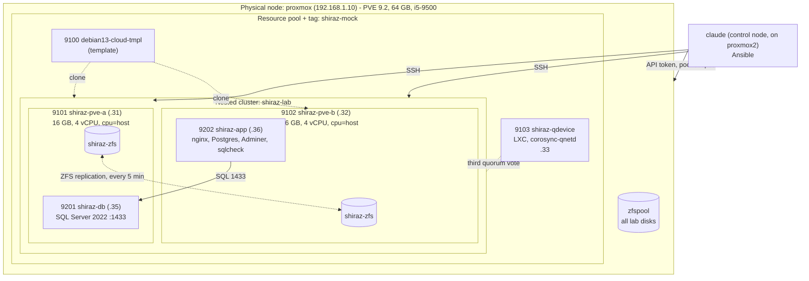

# indaGO Shiraz mock on nested Proxmox

Status: Phase 1 written. Sections marked *pending* are filled in as each phase is built and tested.

## Architecture



All addresses are in 192.168.1.0/24 on the physical `vmbr0`. Each nested host bridges its single
NIC as its own `vmbr0`, so the mock servers sit directly on the LAN.

## Mapping to the DMW&H spec

Rows use only what the spec summary provided for this lab states. Production sizing is left to be
filled in from the vendor document rather than guessed.

| Vendor reference design | This lab | Why |
|---|---|---|
| Two VMware hosts, Host A and Host B | Two nested Proxmox VE 9.2 VMs, `shiraz-pve-a` and `shiraz-pve-b` | Evaluating Proxmox as the VMware replacement; nested so it fits on one physical node |
| vCenter / HA cluster | Proxmox cluster `shiraz-lab` with HA manager | Same role: placement, migration, restart on host failure |
| Third vote / witness | QDevice (`corosync-qnetd`) in a small container | A 2-node cluster cannot keep quorum alone when one node is lost |
| Shared storage | Local ZFS on each host + scheduled replication | Matches the existing home cluster. Asynchronous: see "Storage" below |
| Database server: Windows Server + SQL Server 2022 | `shiraz-db`: Ubuntu 24.04 + SQL Server 2022 for Linux container | No Windows licence needed; same engine, port 1433, same login model |
| Application server (containerized indaGO) | `shiraz-app`: Ubuntu 24.04 + Docker compose stack listening on the spec's ports | Stand-in workloads that exercise the same ports and the app-to-DB dependency |
| Core server | Not built; inventory slot reserved (`shiraz-core`, .37, VMID 9203) | Added later with one inventory entry |
| Server sizing | 6 GB RAM, 2 vCPU, 15 GB disk each | Scaled down to fit. *Production values: fill in from the spec* |
| Firewall ports 22, 80, 443, 1433, 1434, 8080, 8083, 15432, 15433 | Same list, one variable, applied with UFW | See limitation about Docker and UFW |
| Power management disabled | `sleep`, `suspend`, `hibernate`, `hybrid-sleep` targets masked | Mirrors the rule on a Linux guest |
| Vendor support account | Local `dmwh-admin`, sudo, password never expires | Mirrors the account the vendor asks for |
| Daily 30-minute maintenance window | `maintenance.yml`: serial patch + image refresh, timed | Rehearses fitting routine work into the window |

## Design decisions

### Proxmox VE install method
Nested hosts start as the Debian 13 cloud image and are converted with the official
"Install Proxmox VE on Debian 13 Trixie" procedure, expressed as the `pve_host` role. That keeps
the whole install in Ansible. **Real hosts at work would be installed from the Proxmox ISO**
(optionally with the automated installer and an answer file); the end state is the same PVE 9.2.

Differences from an ISO install that the role closes: hostname resolves to the real address in
`/etc/hosts`, cloud-init is disabled after first boot, netplan and systemd-resolved are replaced
by `/etc/network/interfaces` with a `vmbr0` bridge and a static `resolv.conf`, the NIC name is
pinned to `nic0` by MAC, the stock Debian kernel is removed, and sshd allows root and password
logins as the ISO install does.

### Storage: ZFS + replication (default) and the alternatives
| Option | Migration | Host failure | Cost |
|---|---|---|---|
| **ZFS + replication** (built) | Live migration copies only the delta since the last sync | VM restarts on the other host from the last replica: **loses up to one replication interval (5 min)** | No extra hardware; storage is not a single point of failure |
| NFS / iSCSI shared storage | Live migration moves RAM only | VM restarts with no data loss | The storage box becomes a single point of failure and must itself be redundant |
| Ceph | As shared storage | No data loss | Needs three or more nodes and fast networking |

The vendor design assumes shared storage, so its failover loses no committed data. With ZFS
replication the same event rolls the database back by up to the replication interval. For a
warehouse control database that is the main thing to weigh before choosing Proxmox with local
ZFS over shared storage.

### Sizing on the physical node
Each nested host has 16 GB so that either can run both 6 GB mock servers during a drain or
failover (12 GB guests + Proxmox + a 1 GB ZFS ARC). Two hosts plus the QDevice commit 32.5 GB of
the node's 64 GB.

**Capacity warning:** `ubuntudesktop` (24 GB) is HA-managed on `proxmox2`. If `proxmox2` fails
while this lab is running, HA cannot fit it on `proxmox`. The nested hosts therefore do not start
at boot (`onboot: 0`); power the lab off when it is not in use (see runbook).

### Keeping the lab out of the way
- Everything is in pool `shiraz-mock` and tagged `shiraz-mock`.
- The API token has guest permissions on that pool only.
- Lab disks carry `backup=0`, so the node's nightly "back up all guests" job stores only a config
  stub for the nested hosts.
- No physical-cluster HA or replication is configured for lab guests.

## Runbook

*Pending (Phase 4).* Will cover: migrate a VM, drain a host, run the failover test, add
`shiraz-core`, power the lab off and on.

## Enabling nested virtualization (already on for `proxmox`)

Checked with `cat /sys/module/kvm_intel/parameters/nested` (`Y`). If a node shows `N`:

```bash
echo "options kvm-intel nested=Y" > /etc/modprobe.d/kvm-intel.conf   # kvm-amd / nested=1 on AMD
# migrate or shut down the node's guests, then reboot the node
```

## Known limitations of the nested setup

- **Performance is not representative.** Guests run under two hypervisors, and the nested ZFS pool
  sits on a zvol of the physical ZFS pool. Migration and replication timings are for comparing
  procedures, not for sizing.
- **One physical box.** Both "hosts", the QDevice and all storage share one machine, one NIC and
  one power supply. A real host failure is simulated by hard-stopping a nested VM.
- **One network.** Management, cluster (corosync), replication and guest traffic share a single
  bridge. A real deployment separates corosync and storage traffic.
- **Watchdog.** HA fencing uses the software watchdog; real hosts should use a hardware watchdog
  or IPMI.
- **UFW and Docker.** Docker publishes container ports through its own iptables chains, ahead of
  UFW. The UFW rules document the spec's port list and protect host services, but they do not
  gate ports published by containers.
- **Not Windows.** SQL Server runs in a Linux container, so nothing here tests Windows guests,
  VirtIO drivers, or Windows-side maintenance.
